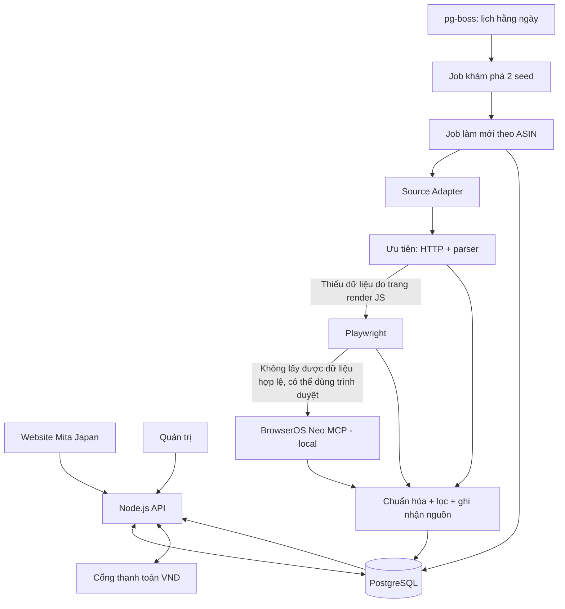

# Mita Japan — Plan backend & thu thập catalog Amazon (Grill Me)

**Ngày:** 27/10/2026 JST  
**Trạng thái:** `accepted` — kế hoạch đã được xác nhận (Q1–Q2); chưa viết backend.  
**Phạm vi ban đầu:** 2 danh mục Amazon Japan, dữ liệu lưu local, sau chuyển lên VPS.  
**Căn cứ:** `GLOSSARY.md`, `docs/backend-architecture.md`, ADR `0001`–`0008`; tham khảo collector của dự án Kaitori.

## 1. Mục tiêu và phạm vi

- Xây **một backend Node.js + TypeScript**, có **API** và **Worker** là hai tiến trình của cùng codebase.
- **PostgreSQL** lưu catalog, lịch sử giá, trạng thái đồng bộ, đơn hàng; **pg-boss** điều phối job và lịch chạy, chưa cần Redis.
- Thu thập/đồng bộ theo danh mục **mỗi ngày 1 lần**; website chỉ đọc PostgreSQL, không chờ quá trình thu thập.
- Tự thêm mọi sản phẩm tìm thấy trong danh mục đã chọn; chỉ cho phép đặt mua khi dữ liệu và điều kiện bán đều đạt yêu cầu. Sản phẩm chưa hợp lệ vẫn có thể lưu với trạng thái bị chặn.
- Triển khai và kiểm thử local bằng Docker Compose; khi phù hợp mới chuyển API/Worker/PostgreSQL lên VPS.
- Website dành cho khách Việt Nam; giá JPY nguồn chuyển thành tiền hàng VND, thu tiền hàng tại checkout, phí vận chuyển thu sau theo các ADR đã chốt.

### Hai nguồn khởi đầu (giữ nguyên URL)

| Nhóm trên Mita Japan | Amazon seed URL | Vai trò |
| --- | --- | --- |
| Thực phẩm bổ sung / chăm sóc sức khỏe | https://www.amazon.co.jp/gp/bestsellers/hpc/3457072051 | Discovery từ trang bestseller thuộc nhánh hpc; **chưa xác minh tên nút danh mục Amazon thực tế** |
| Thực phẩm cho bé | https://www.amazon.co.jp/s?k=%E3%83%99%E3%83%93%E3%83%BC%E3%83%95%E3%83%BC%E3%83%89&i=food-beverage | Discovery từ trang kết quả tìm kiếm tiếng Nhật |

**Giới hạn khám phá đã chốt (Q1):** chỉ theo các trang kết quả/phân trang thuộc 2 seed đã cấu hình; không tự mở rộng sang toàn bộ Amazon. **Tối đa 200 ASIN duy nhất/danh mục/lần quét** (tối đa 400 ASIN cho 2 danh mục trong mỗi đợt). Có thể tăng giới hạn sau khi kiểm chứng tốc độ và độ ổn định. Không khẳng định hai URL đã truy cập/parse thành công trước khi làm thử nghiệm thực tế.

## 2. Sơ đồ tổng thể

**Nguyên tắc:** browser fallback chỉ là một **adapter cho việc thu thập**. Không đưa trình duyệt vào luồng request của khách. Không coi BrowserOS Neo là phương án vượt CAPTCHA/403/429 hoặc bảo đảm quyền tái sử dụng dữ liệu.

## 3. Chiến lược scraping: theo thứ tự, có điểm dừng rõ

| Tầng | Khi nào dùng | Đầu ra / quy tắc |
| --- | --- | --- |
| **1 — HTTP + parser** | Trang và dữ liệu đọc được hợp lệ qua HTTP | HTML/JSON được parse thành sản phẩm chuẩn, tối thiểu nhận diện ASIN; lưu nguồn và thời điểm |
| **2 — Playwright** | Trang yêu cầu JavaScript hoặc parser HTTP không tìm được trường bắt buộc mặc dù trang truy cập hợp lệ | Render trang, kiểm tra dữ liệu được hiển thị; trả cùng schema; không tạo browser cho mỗi ASIN |
| **3 — BrowserOS Neo MCP** | Hai tầng trên không lấy được dữ liệu hợp lệ vì lý do kỹ thuật và Neo có phiên trình duyệt sẵn được phép dùng **trên local** | Sử dụng `http://127.0.0.1:9010/mcp` từ máy local; mở/đọc và trích xuất qua tool MCP; ghi nguồn `browseros-neo`. Job bị chặn chuyển `needs_human`, không tự vượt xác minh. |

**Phân biệt lỗi để quyết định chuyển tầng:**

- **Thiếu trường dữ liệu, markup đổi, JS render:** thử tầng kế tiếp sau khi kiểm tra; kết quả đủ trường mới được ghi là thành công.
- **Network timeout hoặc HTTP 5xx:** retry có giới hạn và backoff trước khi chuyển sang tầng khác.
- **HTTP 429:** tôn trọng `Retry-After`, giảm nhịp/tạm dừng. **HTTP 403, CAPTCHA, yêu cầu đăng nhập/xác minh:** dừng tự động, ghi trạng thái `blocked/needs_human`; không tự động dùng Neo để né chặn.
- **Nguồn không cho phép truy cập hay tái hiển thị nội dung:** dừng công bố nội dung đó; phải xác minh quyền sử dụng của nguồn trước khi hiển thị thương mại.
- **Cả ba tầng thất bại:** giữ snapshot hợp lệ gần nhất; ghi lỗi, không xoá catalog và không làm mới `price_observed_at`. Giá quá 24 giờ thì tạm khóa checkout như ADR `0006`.

**BrowserOS Neo (đã chốt Q2):** chỉ làm fallback **trên local**. Đã xác nhận máy local trả lời MCP initialize ở `127.0.0.1:9010` và công bố các tool `tabs`, `navigate`, `read`, `snapshot`, `run`. **Chưa kiểm chứng Neo đọc thành công 2 trang Amazon này.** Nếu cần thao tác xác minh thủ công/CAPTCHA hoặc thiếu Neo khi triển khai VPS, ghi job `needs_human`/chờ xử lý và giữ catalog hợp lệ gần nhất. `127.0.0.1` trên VPS không trỏ về máy local; phương án fallback ở VPS được thiết kế riêng khi triển khai, không mở công khai cổng MCP.

## 4. Mượn những gì từ Kaitori

- `costco_price/collector.py`: khám phá URL sản phẩm → lọc sơ bộ → lấy chi tiết → lọc lần hai → lưu observations; có thống kê `discovered/saved/skipped/errors`.
- `costco_price/parser.py`: parser độc lập, lấy dữ liệu có cấu trúc/HTML đúng vùng sản phẩm; phân biệt giá/tồn kho chưa biết thay vì đoán.
- `costco_price/db.py`: tách sản phẩm khỏi lịch sử quan sát giá; upsert mã sản phẩm, lưu `observed_at` và lỗi theo lần chạy.
- `poke_dowsing/collector.py`: giới hạn request toàn cục, backoff, retry có giới hạn, checkpoint/resume và thống kê lỗi.
- **Phần thay đổi:** Kaitori sử dụng Python + SQLite/queue RAM; Mita dùng Node.js + PostgreSQL + pg-boss. Kế thừa **nguyên tắc**, không sao chép nguyên code Python hay chạy hai hệ queue.

## 5. Module và ranh giới

| Module | Trách nhiệm |
| --- | --- |
| `catalog` | Đọc danh mục, tìm kiếm, phân trang, chi tiết, biến thể theo ASIN |
| `source-adapters` | HTTP / Playwright / BrowserOS Neo, cùng giao diện `discover(seed, page)`, `getProduct(asin)` |
| `ingestion` | Khám phá, chuẩn hóa, loại trùng, lọc điều kiện bán, upsert và lưu lịch sử |
| `pricing` | Giá JPY → VND, phí dịch vụ; kiểm tra độ mới dữ liệu và giá thanh toán |
| `orders-payments` | Giỏ hàng, guest checkout, thu tiền hàng, phí chuyển sau, hoàn tiền một phần |
| `fulfillment-admin` | Nhân viên mua Amazon, nhận hàng Nhật, gom kiện, giao khách và trạng thái đơn |

**Giao diện nội bộ đề xuất:** `ProductSource.discover(seed, cursor) -> discovered ASIN[]`; `ProductSource.getByAsin(asin) -> ProductObservation | FetchFailure`. Mọi adapter dùng cùng model `asin`, `parentAsin?`, `title?`, `priceJpy?`, `availability`, `image?`, `observedAt`, `sourceUrl`, `sourceAdapter`, `rightsStatus`. Trường không xác minh được để `unknown/null`, không tự điền.

### Dữ liệu logic tối thiểu

- `categories`, `category_seeds`: 2 danh mục và URL/cursor cấu hình.
- `products`, `product_variants`: nhóm sản phẩm và từng ASIN, nguồn, trạng thái được phép hiển thị/đặt hàng.
- `product_observations`: giá JPY, tình trạng, nguồn, `observed_at`, kết quả kiểm tra theo lần thu thập.
- `sync_runs` và `sync_errors`: tình trạng từng lần chạy, ASIN thành công/thất bại, tầng adapter đã dùng.
- `orders`, `order_items`, `payments`, `refunds`, `shipments`: giữ hướng kiến trúc đã chốt, xây vào giai đoạn tương ứng.
- **Queue:** các bảng do pg-boss quản lý; job có ID duy nhất theo `run + ASIN + task` để chạy lại an toàn.

## 6. Queue và nhịp cập nhật

1. `catalog.daily`: hằng ngày theo timezone `Asia/Tokyo` tạo 2 công việc khám phá.
2. `catalog.discover`: lấy ASIN theo seed, khử trùng trong đợt và chỉ lên lịch chi tiết khi cần.
3. `catalog.detail`: gọi source adapter theo chính sách fallback, kiểm tra, lưu observation; mỗi ASIN lỗi không khiến cả batch thất bại.
4. `catalog.finalize`: tổng hợp `success/partial/failed/blocked`; giữ bản catalog gần nhất; không đổi timestamp giá khi chưa lấy được giá hợp lệ.

**Khởi đầu thận trọng:** concurrency thấp, backoff và giới hạn retry; giới hạn chính xác chỉ chốt sau khi thử hai seed và xác minh quyền truy cập. Không dùng Selenium/Elasticsearch/Redis/microservices chỉ vì số lượng sản phẩm tăng từ vài trăm lên vài nghìn.

## 7. Lộ trình xây backend

| Mốc | Công việc | Kết quả kiểm tra |
| --- | --- | --- |
| **0 — Feasibility** | Mở 2 URL bằng công cụ đọc trang được phép; kiểm tra ASIN, giá, biến thể, phân trang, lỗi; quyền lưu và tái hiển thị | Báo cáo được/không được, ví dụ sản phẩm, giới hạn cụ thể |
| **1 — Nền tảng local** | Compose PostgreSQL + Node API + Worker/pg-boss + migration | Khởi động/dừng/khởi động lại không mất dữ liệu |
| **2 — Catalog ingestion** | Seed, schema, HTTP parser, chuẩn hóa, lọc, dedupe, logs, snapshot | Import hai nhóm, tìm theo danh mục, không trùng ASIN |
| **3 — Fallback & chịu lỗi** | Thêm Playwright nếu cần, BrowserOS Neo MCP cuối cùng tại local; retry/resume; tự giữ snapshot tốt | Mô phỏng lỗi từng tầng, resume an toàn, báo trạng thái đúng |
| **4 — API & bán hàng** | Catalog nhanh, tìm kiếm/phân trang, pricing, đặt hàng và thanh toán theo ADR đã chốt | Website đọc DB, không chờ scraper; checkout không dùng giá quá 24h |
| **5 — VPS** | Migrations/backup/HTTPS, secrets, lịch chạy, giám sát, phương án cho Neo fallback | Chạy trên VPS và phục hồi sau restart; có phương án rõ khi Neo không chạy trên VPS |

## 8. Quyết định Grill Me đã chốt

**Q1 — Hạn mức catalog đầu tiên: CHỐT.** Tối đa **200 ASIN duy nhất/danh mục/lần quét**, tổng tối đa 400 ASIN/lần quét cả hai danh mục. Tăng dần sau khi xác minh tốc độ và độ tin cậy.

**Q2 — Vai trò của BrowserOS Neo: CHỐT.** Neo chỉ là **fallback local** sau HTTP parser và Playwright khi lỗi kỹ thuật phù hợp; gặp CAPTCHA, xác minh thủ công hoặc môi trường VPS chưa có Neo thì ghi job chờ xử lý, giữ bản catalog hợp lệ gần nhất.

**Bước tiếp theo:** Từ plan `accepted`, viết spec triển khai khi bắt đầu giai đoạn phát triển. Các chi tiết kỹ thuật còn lại có thể chốt lúc implement mà không cần thêm vòng phỏng vấn dài.

## 9. Lưu ý đồng bộ với frontend

File `.agents/plan/02_garden_frontend_build_plan.md` vẫn nói checkout **yêu cầu báo giá** vì được viết trước Q1–Q19. Quyết định mới trong `GLOSSARY.md` và ADR về **thanh toán tiền hàng ngay, vận chuyển thu sau** được ưu tiên; cần cập nhật frontend spec khi chuyển sang xây ứng dụng.
