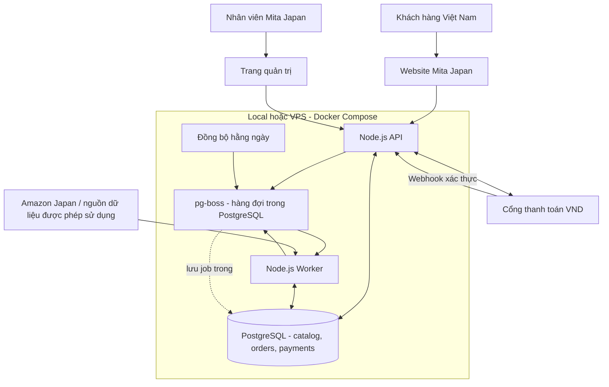
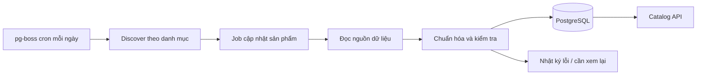
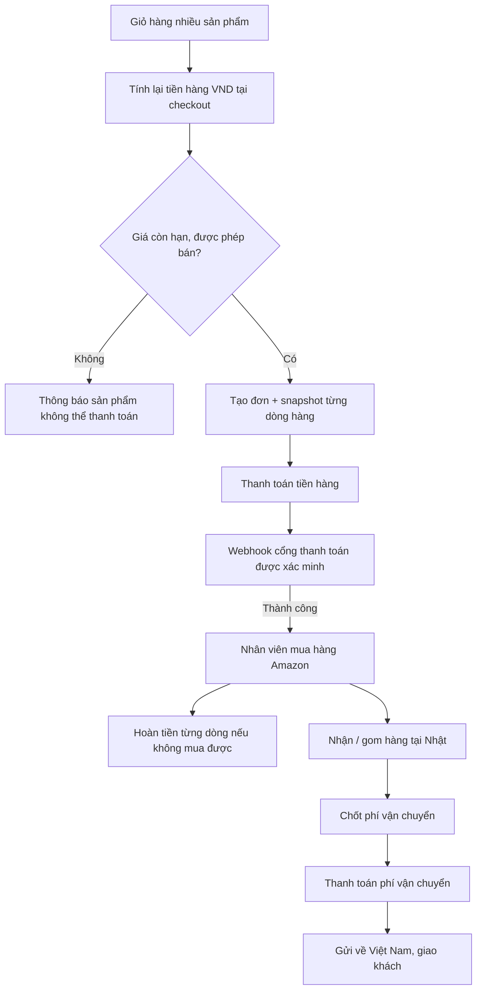

# Mita Japan — Kiến trúc backend tổng thể (đề xuất)

**Trạng thái:** thiết kế kiến trúc, chưa triển khai. Dựa trên các quyết định Q1–Q19 trong `GLOSSARY.md` và `docs/adr/0001`–`0008`.

## 1. Hướng thiết kế

- **Một codebase Node.js/TypeScript**, triển khai dưới hai tiến trình: **API** (phục vụ web/admin) và **Worker** (việc nền). Không cần microservices ở giai đoạn đầu.
- **PostgreSQL** là kho dữ liệu chính. **pg-boss** dùng chính PostgreSQL để lưu hàng đợi và lịch chạy; **chưa cần Redis**.
- **Docker Compose** chạy API, Worker và PostgreSQL tại local; khi lên VPS dùng cùng cấu trúc, thay cấu hình môi trường và thêm cấu hình production.
- Đọc catalog từ PostgreSQL: **không scrape Amazon trong lúc người dùng mở trang**.
- Mỗi ngày worker chạy đồng bộ dữ liệu theo danh mục đã chọn. Dữ liệu mới đi qua kiểm tra tự động trước khi được phép bán.

## 2. Sơ đồ tổng thể



> Sơ đồ mô tả vai trò logic. **pg-boss không phải server hay database thứ hai**, mà là thư viện/hàng đợi dùng bảng trong PostgreSQL. Worker và API có thể dùng chung Docker image với lệnh khởi động khác nhau.

## 3. Sáu module backend chính

| Module | Trách nhiệm | Phục vụ bởi |
| --- | --- | --- |
| **Catalog** | Danh mục, tìm kiếm/lọc, nhóm sản phẩm và biến thể ASIN, trạng thái được phép bán; trả dữ liệu phân trang. | API |
| **Ingestion** | Tìm sản phẩm theo danh mục, lấy dữ liệu từ nguồn, chuẩn hóa, lọc tự động, upsert theo ASIN, lưu lần đồng bộ và lỗi. | Worker |
| **Pricing** | Tính **tiền hàng VND** từ giá JPY và chính sách tỷ giá/phụ phí; ước tính phí vận chuyển theo danh mục; kiểm tra giá quá 24 giờ. | API; dùng lại trong Worker khi cần |
| **Orders** | Giỏ nhiều mặt hàng, guest checkout, tạo đơn và dòng hàng, lưu snapshot giá/ASIN lúc đặt, hỗ trợ hoàn phần thiếu. | API |
| **Payments** | Tạo yêu cầu thanh toán **tiền hàng** và **vận chuyển** riêng; xác minh webhook, chống xử lý trùng, ghi giao dịch và hoàn tiền. | API + Worker |
| **Fulfillment & Admin** | Nhân viên theo dõi đơn đã thu tiền, mua tại Amazon, nhận/gom/tách kiện tại Nhật, báo phí vận chuyển cuối, cập nhật giao hàng. | API + trang quản trị |

Tạm thời **không tách 6 module thành 6 dịch vụ mạng**. Chúng là các thư mục/module trong cùng một backend, chia sẻ PostgreSQL và logic nghiệp vụ cần thiết.

## 4. Hai luồng dữ liệu quan trọng

### A. Cập nhật catalog (chạy nền hằng ngày)



1. Worker duyệt **chỉ những danh mục được cấu hình**, tự thêm sản phẩm tìm thấy; dùng ASIN để nhận diện biến thể, chống nhập trùng.
2. Bộ lọc không cho bán sản phẩm thiếu dữ liệu quan trọng, nội dung không đủ quyền sử dụng hoặc thuộc nhóm hàng bị hạn chế. Dữ liệu không hợp lệ được ghi trạng thái và nguyên nhân, không làm mất toàn bộ catalog.
3. Mỗi kết quả giá có `observed_at`; không lấy giờ chạy job làm giờ xác minh giá nếu lần lấy giá thất bại. Giá quá **24 giờ**: còn xem được nhưng **không checkout**.
4. Worker lỗi: retry có giới hạn, ghi `sync_runs`, giữ bản dữ liệu hợp lệ gần nhất. Không xóa toàn bộ danh mục chỉ vì một lần không tìm thấy sản phẩm.

### B. Đặt hàng và thu tiền hai lần



- **Không coi redirect trình duyệt là bằng chứng đã thanh toán**. Chỉ ghi nhận thanh toán khi đã xác minh thông báo từ cổng hoặc đối soát qua API cổng.
- Cả hai lần thu tiền gắn với **cùng một đơn**, nhưng là **hai giao dịch thanh toán khác nhau**; nhận webhook lặp lại không tạo đơn hoặc trừ tiền hai lần.
- Tiền hàng được chốt tại checkout; phí vận chuyển ước tính chỉ để khách dự trù. Phí cuối được yêu cầu thanh toán ở giai đoạn sau.
- Nếu chỉ mua được một phần, lưu kết quả **trên từng dòng hàng**, hoàn phần tiền hàng không mua được và tiếp tục xử lý các dòng còn lại.
- Khách có thể mua không cần tài khoản; theo dõi đơn qua kênh có xác minh quyền truy cập (chưa chốt hình thức).

## 5. Các nhóm dữ liệu PostgreSQL

Đây là **mô hình logic**, chưa chốt chi tiết cột và khóa:

| Nhóm | Bảng dự kiến | Dùng để |
| --- | --- | --- |
| Catalog | `categories`, `products`, `product_variants` | Nhóm danh mục, thông tin sản phẩm và ASIN theo biến thể |
| Giá & đồng bộ | `product_offers`, `sync_runs` | Giá nguồn + thời điểm xác minh, trạng thái cập nhật |
| Đơn hàng | `orders`, `order_items` | Đơn hàng, snapshot giá và trạng thái từng dòng |
| Thu và hoàn tiền | `payments`, `refunds` | Giao dịch hai đợt và hoàn tiền một phần |
| Vận chuyển | `shipments`, `shipment_items` | Gom/tách kiện, phí và hành trình giao hàng |
| Hàng đợi | Schema do **pg-boss** quản lý | Job, retry, lịch chạy; không tự thiết kế bảng queue |

Giá bán VND, tỷ giá và chính sách phụ phí phải được **lưu snapshot theo đơn**. Cập nhật giá catalog ngày hôm sau không được thay đổi số tiền hàng của đơn đã thanh toán.

## 6. Job queue ban đầu

| Job | Khi nào | Hành vi |
| --- | --- | --- |
| `catalog.discover` | 1 lần/ngày theo giờ cấu hình JST | Tìm và xếp hàng sản phẩm thuộc danh mục đã chọn |
| `catalog.refresh` | Do `discover` tạo | Cập nhật từng nhóm ASIN; retry lỗi tạm thời, giới hạn đồng thời |
| `order.paid` | Sau thanh toán tiền hàng **được xác nhận** | Cập nhật công việc mua hộ cho nhân viên; xử lý lặp an toàn |
| `payment.refund` | Khi nhân viên xác nhận dòng hàng không mua được | Gửi yêu cầu hoàn theo chính sách cổng thanh toán, theo dõi kết quả |

Chỉ xây các job cần thiết; cập nhật trạng thái kiện và thu tiền vận chuyển ban đầu có thể là thao tác admin qua API. **Job phải xử lý lặp an toàn** vì hàng đợi có thể phát lại khi worker lỗi.

## 7. Triển khai local rồi chuyển VPS

```text
mita-japan backend (cấu trúc gợi ý, chưa tạo code)
├── src/
│   ├── api/                HTTP endpoints, webhook, admin
│   ├── modules/            catalog, ingestion, pricing, orders, payments, fulfillment
│   ├── worker/             pg-boss jobs và scheduler
│   └── db/                 truy vấn và migrations
├── compose.yaml            API + Worker + PostgreSQL
└── compose.production.yaml cấu hình riêng cho VPS (khi triển khai)
```

- **Local:** Docker Compose chạy PostgreSQL với volume lưu dữ liệu; API và Worker chạy qua Compose hoặc Node.js trên máy phát triển, trỏ vào cùng PostgreSQL. Dùng sản phẩm mẫu khi nguồn thật chưa được cấp quyền.
- **VPS:** giữ cùng code, migrations và cấu trúc Compose; dùng HTTPS/reverse proxy, secrets riêng, volume bền vững và lịch backup PostgreSQL. Khóa truy cập trực tiếp database từ internet; webhook nhận qua HTTPS.
- **Chuyển dữ liệu:** backup/restore PostgreSQL và kiểm tra phiên bản/migrations, kiểm tra payment webhook ở môi trường mới trước khi nhận thanh toán thật.

## 8. Phần để giai đoạn triển khai chốt sau

Chưa cần quyết định ở cấp sơ đồ: framework HTTP cụ thể, cổng thanh toán VND cụ thể, bảng chi tiết, công thức tỷ giá/phí, hãng vận chuyển, giao diện quản trị, cảnh báo và lịch chạy chính xác. Các mục này không làm thay đổi hình dạng chính của kiến trúc.

**Điều kiện quan trọng đối với nguồn Amazon:** `Ingestion` là vị trí có thể thay adapter thu thập dữ liệu; thiết kế này **không mặc định scraping, lưu ảnh, giá hoặc tái đăng nội dung Amazon được phép**. Cần xác minh quyền truy cập và quyền tái hiển thị cho mô hình mua hộ trước khi sử dụng dữ liệu thật công khai. Bộ lọc tự động cũng không thể tự bảo đảm một sản phẩm được phép nhập khẩu hoặc bán tại Việt Nam; cần có quy tắc kinh doanh/pháp lý được kiểm chứng. Không xây cơ chế vượt CAPTCHA hoặc chặn truy cập.

## Nguồn kỹ thuật tham chiếu

- pg-boss Introduction: https://pgboss.io/introduction
- pg-boss Scheduling: https://pgboss.io/api/scheduling
- Docker Compose production: https://docs.docker.com/compose/how-tos/production/
- Amazon Associates policies (JP): https://affiliate.amazon.co.jp/help/operating/policies/

## Scrapling collection (Windows PC)

Live daily collection and Admin Import use a persistent Python `FetcherSession` with BeautifulSoup. HTTP/Cheerio functions remain only for old offline fixtures; there is no automatic HTTP or BrowserOS fallback. Neo is available only via the explicit `worker:captcha:open` owner command.

Run `powershell -NoProfile -ExecutionPolicy Bypass -File scripts/setup-scrapling.ps1` from the repo root. This creates `backend/.venv-scrapling` and installs pinned Scrapling 0.5 and BeautifulSoup 4.15.0. No global Python installs or browser downloads are required. `scripts/check-scrapling.ps1` checks exact versions and the session API without fetching a page. Both Windows launchers run this preflight. An absolute `MITA_SCRAPLING_PYTHON` can select another dedicated environment with those versions. Python 3.12 was used for verification.

Node owns the source-wide advisory lock, persistent source block, existing queue and all DB writes. Python receives an environment allowlist with no DB credentials. One lazy Python process lasts for a sync; each Admin Import has a bounded session. Requests are sequential JSONL, capped at 4 KiB outbound and 2 MiB inbound, with a 110-second request deadline. Page bodies are rejected above 8 MiB after receipt. EOF, cancellation, worker signals, protocol failure and timeout close/kill the process. Hard Windows stops use the existing recursive process-tree stop scripts. A failed subprocess has no alternate source engine.

Python paces requests at least 1.2 seconds after the previous completion. It makes at most three total attempts for network/timeouts/408/5xx, with internal Scrapling retries disabled. 403/429, actual CAPTCHA/login/verification forms latch the session and are persisted as the existing `needs_human` source block before another request can be issued. Redirect following is disabled, including same-domain redirects: redirect-only pages need review instead of an implicit second request. Canonical/input ASIN contradictions, off-domain identities and unverified galleries are rejected. The current DB block must remain unchanged until a separately authorized manual verification/ACK.

Both seed listings feed the existing detail queue. HTML swatches and product-bound JSON variation maps reveal child ASINs; Python never fetches them recursively. Node enqueues them through the normal queue, and all attempted unique detail ASINs share the existing ceiling of 200 per category/run. A run caches both successful and failed ASIN reads across categories (maximum 400 keys); overflow remains queued. Child title, price, images and attributes come only from that child's separate detail page.

Gallery photos retain observed Amazon URLs, deduplicate resize identities using the highest observed resolution, and exclude recommendations and other child galleries. Full gallery persistence removes the old five-position constraint with an idempotent schema upgrade; partial galleries do not replace prior valid complete galleries. Run the normal migration only when separately authorized for the target DB. No migration of the current DB is performed by this code change. Rights, hidden status, valid snapshots and price freshness remain under the existing store rules. The independent 04:00 JST Amazon and 05:00 JST name translation schedules are unchanged.

Offline checks:

```powershell
backend/.venv-scrapling/Scripts/python.exe -B -m unittest discover -s backend/python -p 'test_*.py' -v
npm --prefix backend run typecheck
npm --prefix backend run build
npm --prefix backend test
```

`backend/tests/scrapling.test.ts` uses a local JSONL fixture subprocess; it never calls Amazon. `MITA_SCRAPLING_TEST_PYTHON` can specify an absolute Python interpreter for those IPC tests. The DB suite uses disposable test databases.
